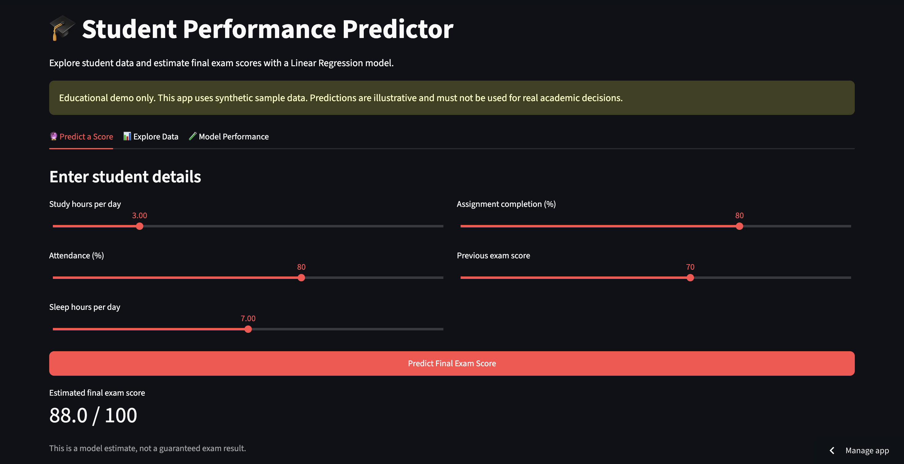
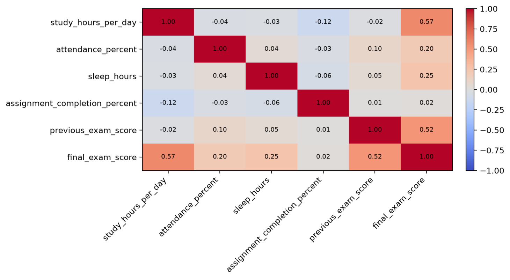
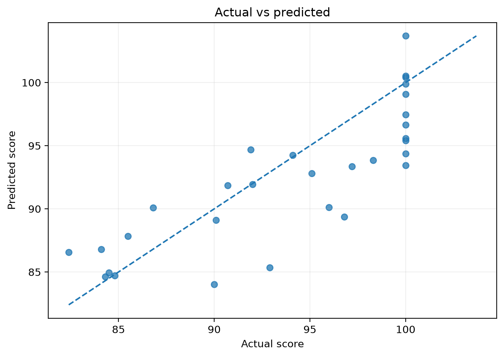
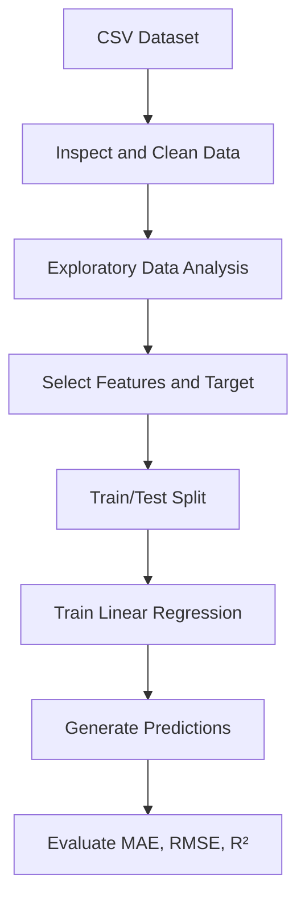

<div align="center">

# 🎓 Student Performance Analysis & Score Prediction

## 🚀 Live Demo

**Try the live application here:**  
👉 [Student Performance Predictor](https://student-performance-analysis-ml-zhhp69adhbpbz7sp9qgeyg.streamlit.app/)

A machine learning web application that predicts student exam scores using academic and lifestyle factors.

### Turning student data into insights with Python, visual analytics, and machine learning.


**[Explore the Notebook](notebooks/student_analysis.ipynb) · [Run the Model](src/train_model.py) · [View Screenshots](docs/screenshots/)**

</div>

---

## 📌 Overview

This end-to-end portfolio project explores relationships between study habits, attendance, sleep, assignment completion, previous exam performance, and final exam scores. It demonstrates a practical workflow from raw data inspection to cleaning, visualization, model training, and evaluation.

> **Dataset note:** This repository uses a small, synthetically generated dataset for learning and demonstration. It does not contain real student records, and results should not be used to make real academic decisions.

## 🎯 Project Goals

- Explore factors associated with final exam performance.
- Clean and prepare data for analysis.
- Visualize distributions and relationships between features.
- Train a regression model to estimate final exam scores.
- Evaluate predictions with standard regression metrics.

## ✨ Key Features

- **Data quality checks:** inspect dataset shape, data types, missing values, and summary statistics.
- **Data cleaning:** impute missing numeric values using the median.
- **Exploratory data analysis:** scatter plots and a correlation heatmap.
- **Machine learning:** train a Linear Regression model with a reproducible train/test split.
- **Evaluation:** calculate MAE, RMSE, and R².
- **Interpretability:** inspect model coefficients.
- **Reusable code:** run the training script or explore the notebook interactively.

## 📊 Project Preview

### Study hours vs. final exam score


### Correlation between features


### Actual vs. predicted scores


## 🧰 Tech Stack

| Tool | Purpose |
|---|---|
| Python | Core programming language |
| Pandas, NumPy | Data manipulation and numerical operations |
| Matplotlib, Seaborn | Data visualization |
| Scikit-learn | Train/test split, Linear Regression, evaluation metrics |
| Jupyter Notebook | Exploratory analysis and documentation |

## 🗂️ Dataset

The CSV contains **150 synthetic student records**.

| Column | Description |
|---|---|
| `student_id` | Synthetic student identifier |
| `study_hours_per_day` | Average study hours per day |
| `attendance_percent` | Attendance percentage |
| `sleep_hours` | Average sleep hours |
| `assignment_completion_percent` | Percentage of assignments completed |
| `previous_exam_score` | Score in a previous exam |
| `final_exam_score` | Target variable |

The sample data includes a few missing values to demonstrate cleaning.

## 🔬 Methodology



### Model setup

- **Algorithm:** Linear Regression
- **Input features:** 5 academic and lifestyle variables
- **Target:** `final_exam_score`
- **Test size:** 20%
- **Random state:** 42 for reproducibility

### Evaluation metrics

- **MAE:** average absolute difference between actual and predicted scores.
- **RMSE:** penalizes larger errors more strongly than MAE.
- **R²:** measures the proportion of target variance explained on the test split.

The sample run achieved approximately **R² = 0.62**. This is a demonstration result, not evidence of real-world predictive performance.

## 🚀 Getting Started

### 1. Clone the repository

```bash
git clone https://github.com/ayushvijaycode/student-performance-analysis-ml.git
cd student-performance-analysis-ml
```


### 2. Create and activate a virtual environment

**macOS / Linux**
```bash
python3 -m venv .venv
source .venv/bin/activate
```

**Windows**
```bash
python -m venv .venv
.venv\Scripts\activate
```

### 3. Install dependencies

```bash
pip install -r requirements.txt
```

### 4. Run the Streamlit Application

```bash
streamlit run app.py
```

Open the local URL displayed in your terminal to use the Student Performance Predictor.

### 5. Train the Model (Optional)

To retrain the machine learning model, run:

```bash
python src/train_model.py
```

### 6. Explore the Jupyter Notebook

Open `notebooks/student_analysis.ipynb` in Jupyter Notebook or VS Code.

Ensure the dataset is available at `data/student_performance.csv` and run Jupyter from the project root directory.

## 📁 Repository Structure

```text
student-performance-analysis-ml/
├── data/
│   └── student_performance.csv
├── docs/
│   └── screenshots/
│       ├── actual-vs-predicted.png
│       ├── correlation-heatmap.png
│       └── streamlit-app.png
├── notebooks/
│   └── student_analysis.ipynb
├── results/
│   ├── actual_vs_predicted.png
│   ├── correlation_heatmap.png
│   └── study_vs_marks.png
├── src/
│   └── train_model.py
├── tests/
│   └── test_dataset.py
├── .gitignore
├── LICENSE
├── PROJECT_INFO.md
├── README.md
└── requirements.txt
```

## 🧪 Basic Data Validation

Run the lightweight dataset checks:

```bash
python -m unittest discover -s tests
```

## ⚠️ Limitations

- The dataset is synthetic and small; it cannot establish real-world relationships.
- Linear Regression assumes a linear relationship between features and target.
- A single train/test split may not represent performance on new populations.
- Correlation and model coefficients do not establish causation.
- This educational project should not be used to grade, rank, or make decisions about real students.

## 🛣️ Future Improvements

- Compare Linear Regression with Random Forest and other regression models.
- Add cross-validation and residual analysis.
- Build an interactive Streamlit dashboard.
- Add a prediction form with input validation.
- Evaluate on a suitable, ethically sourced real-world dataset.

## 👨‍💻 Author

**Ayush** · BTech CSE, IIIT Una

If this project was useful, feel free to ⭐ the repository.

---

<div align="center">Made with Python 🐍 · Data Analysis 📊 · Machine Learning 🤖</div>
